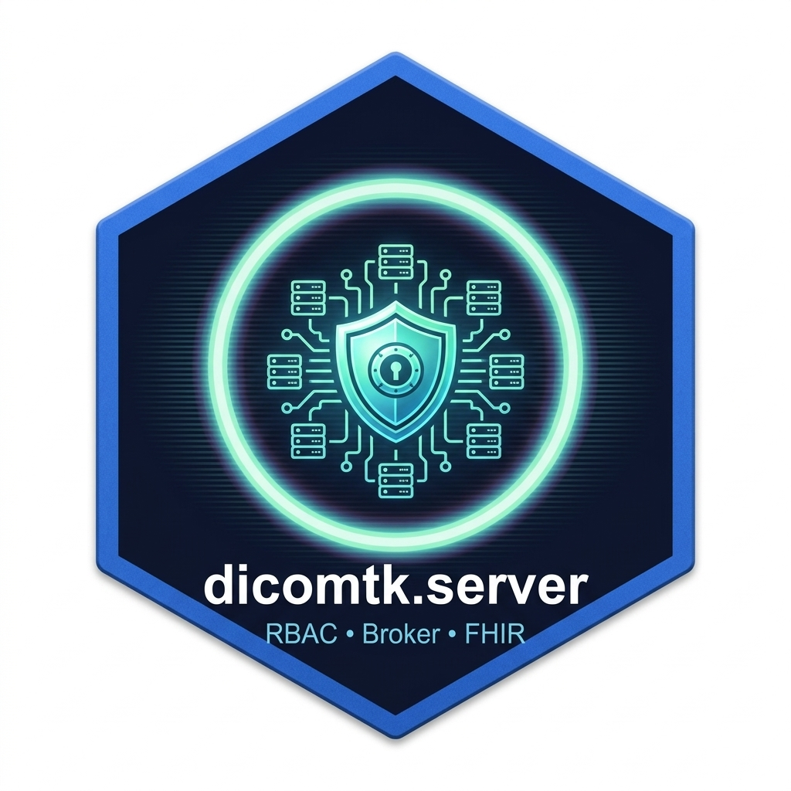

# dicomtk.server: Multi-User Research Server, Honest Broker Custody & Clinical EHR Integration 

<!-- badges: start -->
[](https://lauyeehow1986-hub.r-universe.dev)
<!-- badges: end -->

`dicomtk.server` (`1.0.0`) is the multi-user governance, honest-broker custody, and clinical deployment server for [`dicomtk`](https://lauyeehow1986-hub.github.io/dicomtk/). It provides 8-role OIDC/Keycloak RBAC, a tamper-evident SHA-256 hash-chained JSONL audit log, a walled-off honest-broker key enclave with two-person (`honest_broker` + `dpo`) re-identification, `mirai` async QA (`Dice`, `HD95`, surface `Dice`), MONAI Label active learning, `plumber` REST + `shiny` clinician portals, **SMART on FHIR v2 EHR-launch (PKCE S256)**, **IHE AIW-I / AIR**, **dual-gated SaMD clinical write-back**, and **CycloneDX 1.5 SBOM + STRIDE threat modeling**.

---

## Installation

```r
install.packages(
  "dicomtk.server",
  repos = c(
    "https://lauyeehow1986-hub.r-universe.dev",
    "https://cloud.r-project.org"
  )
)
```

Or install from GitHub:

```r
remotes::install_github("lauyeehow1986-hub/dicomtk.server")
```

---

## How to Use `dicomtk.server`

### 1. 8-Role RBAC & Tamper-Evident Hash-Chained Audit Log
```r
library(dicomtk.server)

ctx <- server_create_context(base_dir = tempfile("srv_"))
pi_user <- server_principal(user_id = "dr_tan", role = "pi")
broker_user <- server_principal(user_id = "hb_01", role = "honest_broker")

# RBAC enforces strict separation of duties
check_permission(pi_user, "cohort:read_deid")
```

### 2. Walled-Off Honest-Broker Enclave & Two-Person Re-Identification
```r
enclave <- broker_enclave_init(file.path(ctx$base_dir, "enclave"))

# Two-person (honest_broker + dpo) dual approval required to re-identify a pseudonym
# req <- reid_request(ctx, pi_user, study_uid = "1.2.840.10008.1", reason = "Safety follow-up")
# reid_approve(ctx, broker_user, req$request_id)
# reid_disclose(ctx, dpo_user, req$request_id)
```

### 3. SMART on FHIR v2 EHR-Launch (RFC 7636 PKCE S256)
```r
pkce <- smart_pkce_challenge()
auth_url <- smart_build_auth_url(
  authorize_endpoint = "https://ehr.hospital.org/oauth2/authorize",
  client_id = "dicomtk_samd_app",
  redirect_uri = "https://samd.hospital.org/callback",
  pkce = pkce,
  launch = "ehr-launch-ctx-123"
)
```

### 4. IHE AIW-I Workitems, IHE AIR Bundles & Dual-Gated SaMD Write-Back
```r
# IHE AIW-I UPS-RS workitem state machine
wi <- ihe_aiw_workitem(study_uid = "1.2.840.10008.1", ae_title = "AI_ENGINE")
wi <- ihe_aiw_transition(wi, "IN PROGRESS")
wi <- ihe_aiw_transition(wi, "COMPLETED")

# Dual-gated clinical write-back: 'final' requires verified_by clinician sign-off
clinical_writeback_enabled()
```

### 5. CycloneDX 1.5 SBOM, STRIDE Threat Model & REST / Shiny Server
```r
sbom <- server_generate_sbom()
stride <- server_threat_model()

# Launch plumber REST API (/health, /sbom, /threat-model, /audit) or Shiny portal
# server_plumber_api(ctx)
```

### 6. Documentation
Browse the full reference at https://lauyeehow1986-hub.github.io/dicomtk.server/.
